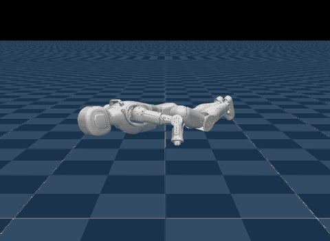

# Asimov 1 (`asimov`)



Source: https://github.com/openhorizon-labs/asimov-v1-policies (Apache-2.0) · walking
policy from https://huggingface.co/Menlo/asimov1-locomotion-0818 (BSD-3-Clause) · get-up
and safe-fall policies from
https://huggingface.co/openhorizon-labs/asimov1-getup-safefall (Apache-2.0) · robot
model from https://github.com/menloresearch/asimov-1 (**CERN-OHL-S-2.0 or GPL-2.0**, see
[License](#license)) · robot: [Asimov](https://asimov.inc) by Menlo Research

Asimov 1, Menlo Research's open-source 1.2 m humanoid, with three policies on one scene:

- **`walk`**, Menlo's own walking policy, follows a velocity command: mjlab's, drawn
  anew every 3 to 8 s, or the panel's joystick. Each episode starts standing at a random
  heading and lasts 20 s, unless the robot tips past 70°.
- **`getup`**, OpenHorizon Labs' get-up policy, starts each episode from one of
  upstream's 512 settled fall states (prone, supine, on a side or in between) at a
  random heading. The robot stands within about two seconds and holds the stance until
  the 20 s episode ends and the next fall begins.
- **`safefall`**, OpenHorizon Labs' safe-fall policy, starts each 3 s episode standing,
  pushed at 0.8 to 2.0 m/s in a random direction. The robot holds its default pose until
  it tips past 30° or turns faster than 2 rad/s, then the policy takes over and lands it
  on its front or back. In mjlab, over 64 pushes, the hardest ground hit on the head,
  torso, pelvis or a knee has a median of 196 N, against 5207 N with the pose held
  throughout.

Switching policies starts the chosen one from its own reset, so the get-up does not pick
up a walk that fell. OpenHorizon says its policies have only run in simulation.

## Run

```sh
uv run msp run asimov
```

The first build clones both repositories into `.cache/` at pinned commits and downloads
the three policies, and the get-up's and the safe fall's specs, from the Hub at pinned
revisions. Set `MJSWAN_ASIMOV_ROOT` and `MJSWAN_ASIMOV_MODEL_ROOT` to use checkouts you
already have. Installed, upstream registers its tasks through mjlab's entry point;
[`upstream.py`](upstream.py) imports `asimov_policies.tasks` from the checkout's `src/`
instead, with `ASIMOV_1_MODEL_DIR` at the asimov-1 checkout in place of the submodule the
clone leaves empty.

| From upstream | Used as |
|---|---|
| `make_getup_env_cfg(..., play=True)` at `695ceba`, the commit both OpenHorizon policies were trained at, with flat ground | the scene (the robot with upstream's collision overlay), and the get-up's observations, action term, terminations and reset |
| `make_safefall_env_cfg(..., play=True)` at `695ceba`, with flat ground | the safe fall's observations, terminations and reset |
| `data/fall_states.v1-local/fall_states.npz` at `695ceba` | the get-up's 512 fall states; later commits delete the file |
| `policies/getup.onnx` on the Hub at `f657abe` | the get-up policy (375 → 23), its normalizer inside the graph |
| `policies/safefall.onnx` on the Hub at `f657abe` | the safe-fall policy (375 → 23), its normalizer inside the graph, wrapped in its fall trigger by [`safefall.py`](safefall.py) |
| `policies/getup_policy_spec.json` on the Hub at `f657abe` | the action's joint order and the default pose, for all three policies: the ONNX carries no mjlab metadata |
| `policies/safefall_policy_spec.json` on the Hub at `f657abe` | the trigger's deployed thresholds and where the wrapper finds its inputs in the observation; the build checks its joint order and default pose against the get-up's |
| `Menlo/asimov1-locomotion-0818` on the Hub at `18114a7`: `policy.onnx` | the walking policy (78 → 23), with no normalizer, as its training config sets |
| the same revision's `env.yaml`, its Isaac Lab training config | the walking MDP, restated in [`walk.py`](walk.py), and the scene's torque limits |
| asimov-1 `sim-model/` at `35ae7b3`, the submodule's commit | the robot's MJCF and meshes |
| `LICENSE`, `NOTICE`; asimov-1's `HARDWARE-LICENSE.txt`, `SOFTWARE-LICENSE.txt` | the project's license and notice; two of the scene's attributions |

## What the policies read

`walk` reads 78 values at 50 Hz:

| Term | Width | Source |
|---|---|---|
| `base_ang_vel` | 3 | the pelvis's angular velocity, × 0.25 |
| `projected_gravity` | 3 | gravity in the pelvis frame |
| `command` | 3 | the velocity command: forward, sideways, turning |
| `joint_pos_slot01`, `_slot23`, `_slot45` | 9, 8, 6 | joint positions minus the default pose, in upstream's CAN slot order |
| `joint_vel_slot01`, `_slot23`, `_slot45` | 9, 8, 6 | joint velocities × 0.1, same order |
| `actions` | 23 | the previous action |

`getup` and `safefall` read the same five terms over the last five control steps, each
term's five values oldest first:

| Term | Width | Source |
|---|---|---|
| `base_ang_vel` | 3 × 5 | the IMU gyro on `imu_in_pelvis`, × 0.25 |
| `projected_gravity` | 3 × 5 | gravity in the pelvis frame |
| `joint_pos` | 23 × 5 | joint positions minus the default pose, in upstream's CAN slot order |
| `joint_vel` | 23 × 5 | joint velocities × 0.1, same order |
| `actions` | 23 × 5 | the previous action applied: for `safefall`, zero until the trigger fires |

All three set each of the 23 joints' targets to the default pose plus 0.25 × the action,
in the model's joint order, which differs from the observations'.

## What differs from upstream

### All three policies

- **Flat ground.** Upstream's play keeps training's ground, 70% of it heightfields with
  2 to 5 cm bumps. On those, mujoco_warp, which mjlab runs, gives a box or capsule at
  most one contact and the browser's MuJoCo several, and a robot lying down touches the
  ground with exactly those shapes. [`upstream.py`](upstream.py) and
  [`safefall.py`](safefall.py) build the configs with upstream's own `rough=False`: a
  plane, and the resets' spawn heights for flat ground. In mjlab, with upstream's
  motors, the get-up falls back in 5 of 128 starts on the heightfield and in none on the
  plane.
- **The actuators run as PD within the effort limit.** mjswan runs upstream's
  `DcMotorActuatorCfg` as the `IdealPdActuatorCfg` it subclasses, which drops the
  motors' torque-speed curve and their 0 to 25 ms command delay. In mjlab, from 128 fall
  states on the plane, the get-up stands every time either way, in a median 1.23 s with
  upstream's motors and 1.12 s without. In MuJoCo's C build, with the browser's PD, the
  safe fall's hardest hit has a median of 254 N over 64 pushes, against 2145 N with the
  pose held.
- **The limits are `env.yaml`'s.** The walking policy trained with 45 N·m at the hips'
  pitch and roll and at the knees and 28 N·m at the hips' yaw, where upstream takes the
  motors' rated 40, 30, 25 and 20 N·m. [`walk.py`](walk.py) raises them on the scene all
  three policies share. In MuJoCo's C build, which the browser runs, with the browser's
  PD, the walk fell in 5 of 100 20-second runs of random commands at the rated limits
  and in none at `env.yaml`'s; in mjlab the get-up stood from all of 64 fall states at
  either, and the safe fall's median hardest hit was 217 N at the rated limits and 196 N
  at `env.yaml`'s.
- **One robot, not a population.** The resets' draws come from the browser's seeded
  PRNG, where mjlab draws them per env.

### `walk`

- **The MDP is restated from `env.yaml`.** Menlo trained the policy in Isaac Lab, so it
  has no mjlab task. [`walk.py`](walk.py) writes `env.yaml`'s observations, velocity
  command and terminations on upstream's get-up scene, whose `robot.py` copies Menlo's
  joint order, default pose, PD gains, armature, joint friction and action scale.
  Menlo's own mjlab ports do not fit:
  [menloresearch/mjlab](https://github.com/menloresearch/mjlab) trains a different recipe
  and ships no policy, and [asimov-mjlab](https://github.com/menloresearch/asimov-mjlab)
  is the legs-only Asimov.
- **Play's conditions.** Training adds noise and delays to the observations, randomizes
  the feet's friction, the joints' zeros, the torso's centre of mass and the PD gains,
  pushes the robot every 1 to 3 s and resets it up to 0.5 m and 0.5 rad off the default
  pose. None of that happens here, as in mjlab's play: each episode starts at the
  default pose, facing a random heading.
- **MuJoCo, not PhysX.** The policy never trained on MuJoCo's contacts, and `env.yaml`
  gives joint friction as a PhysX coefficient, which upstream's entity takes as a
  frictionloss in N·m. In mjlab, 32 robots over 20 s of `env.yaml`'s random commands
  kept within 0.13 to 0.15 m/s of the command, and none fell at `env.yaml`'s limits.

### `getup` and `safefall`

- **No observation delays.** Upstream trains `base_ang_vel` behind a delay of 0 to 1
  control steps and `projected_gravity` behind 0 to 2. mjswan reads the current value,
  the low end of both ranges.
- **`nan_detection` without `|=`.** mjlab's own term builds its mask in place, which
  `torch.onnx.export` cannot export (`aten::__ior_`); [`terms.py`](terms.py) restates
  it with `|`.
- **No encoder bias.** Play randomizes nothing, and the policies' specs carry none.

### `getup`

- **The reset is a function.** Upstream's `reset_from_fall_states` is a class that loads
  its table in `__init__`, and mjswan traces a term by calling it. [`terms.py`](terms.py)
  restates it as a function with the same table and draws: from the same seed it writes
  the same root pose and joint positions as upstream's class.
- **No `assist_force`.** It is the training curriculum's upward pull on the torso, whose
  scale play already holds at zero. It goes with the curriculum, the rewards and the
  metrics, which only train.

### `safefall`

- **The trigger is in the policy.** Upstream's action term,
  `TriggeredJointPositionActionCfg`, holds the action at zero, the default pose, until
  the pelvis tips past a tilt or turns faster than a rate, then passes the policy's
  action through until the episode ends. mjswan has no counterpart for it.
  [`safefall.py`](safefall.py) wraps the ONNX in the same test, on the newest gravity
  and gyro values in the policy's own observation, and keeps whether it fired in the
  policy's recurrent state, which mjswan clears at each reset. The scene runs a plain
  joint-position action on the wrapper's output, which is the action applied, so the
  observation's previous action stays upstream's. In mjlab, with the motors' command
  delays off in both, this scene and upstream's run 64 pushes identically, step for
  step.
- **The deployed thresholds.** Training draws the tilt anew each episode from 20 to 45°
  and the rate from 2 to 4 rad/s. The wrapper fixes them at the 30° and 2 rad/s that
  upstream's spec gives for deployment.
- **The reset draws through `sample_uniform`.** Upstream's `reset_standing_with_push`
  draws with `Tensor.uniform_`, which mjswan's tracer cannot follow.
  [`terms.py`](terms.py) restates it with mjlab's `sample_uniform`, from the same ranges
  in the same order.
- **Only the actor's observations, and no rewards, curriculum or metrics.** The critic's
  observations and one of the metrics read the trigger off upstream's action term, which
  the scene no longer has, and all of them only train.

## License

The tasks, the code and the get-up and safe-fall policies are Apache-2.0. The safe-fall
ONNX the build ships is changed, wrapped in its trigger, and says so in its doc string,
as Apache-2.0 asks of a changed file. Menlo's walking policy is BSD-3-Clause by its model
card, which names no copyright holder; the build ships the standard text as
`LICENSE.asimov1-locomotion` under Menlo Research, the holder its training code names.
The robot model is neither: menloresearch/asimov-1 licenses its hardware under
CERN-OHL-S-2.0 and its software under GPL-2.0 without saying which covers `sim-model/`,
the MJCF and STL meshes compiled into `scene.mjz` (upstream's open question Q1). Both are
reciprocal. The build ships both texts beside the scene, as `LICENSE.asimov-1-hardware`
and `LICENSE.asimov-1-software`, and `mjswan publish` warns on the GPL-2.0 file.
Publishing the demo is its author's call, under those terms.
