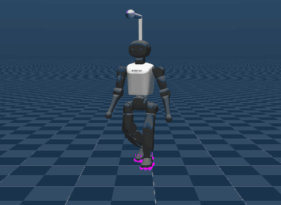

# Booster K1 Walking (`booster`)



Source: https://github.com/IntelligentRoboticsLab/booster_mjlab (**no license stated**, see
[License](#license)) · project page: https://intelligentroboticslab.github.io/booster_mjlab/

A Booster K1 humanoid walking to velocity commands on flat ground, with the policy the
project page runs live in the browser. The command is drawn anew every 1 to 4 s, a fifth
of the time standing still, as upstream's play config draws it, and mjlab's joystick
panel can take over. Play also keeps upstream's random pushes, one every 1.5 to 4 s.

Upstream's other tasks, `Mjlab-Tracking-Flat-Booster-K1` and the velocity tasks on rough
ground or with the parallel-linkage ankle (`-Parallel`), publish no checkpoint, so they
are left out. The project page's kick, side flip and Thomas flare come from the tracking
task, and neither their checkpoints nor their clips are published: not in the repository,
on its Hub organization (`whirlwind-ams`, datasets only) or on the team's site.

## Run

```sh
uv run msp run booster
```

The build clones the repository into `.cache/` at a pinned commit; set
`MJSWAN_BOOSTER_ROOT` to point at a checkout you already have. Upstream is a package that
requires Python 3.13, which the playground cannot install, so [`upstream.py`](upstream.py)
puts its `src/` on `sys.path` and imports `booster_mjlab.tasks`, which registers the tasks.
The code imports under the playground's 3.12 as it is.

| From `booster_mjlab` | Used as |
|---|---|
| `Mjlab-Velocity-Flat-Booster-K1` (`play=True`) | the scene, the observations, the action term, the command, the terminations and the startup randomization |
| `website/static/demo/policy.bin`, `scene.json` | the policy (75 → 22), rebuilt as ONNX; `scene.json` gives the joint order and the rest pose |

The project page's exporter, `scripts/export_web_demo.py`, flattened the run's ONNX into
raw float32 weights and a list of layers: the observation normalizer (`Sub`, `Div`) and an
MLP of 512, 256 and 128 ELU units. `upstream.py` writes those layers back as ONNX, which
agrees with upstream's own evaluator to float32 rounding. `scene.json`'s observation order,
joint order, PD gains and rest pose are the flat config's, and its action scales are the
config's rounded to three decimals. The project page calls the run
(`2026-09-18_18-14-22`) its AMP velocity policy without naming its task. The flat `-Amp`
tasks share this policy's observation, action and command with the plain flat task, which
the scene runs, and their play differs from it only in its resets (see
[What differs from upstream](#what-differs-from-upstream)).

## What the policy reads

Six terms, one frame, no history:

| Term | Width | Source |
|---|---|---|
| `base_ang_vel` | 3 | the `imu_ang_vel` sensor |
| `projected_gravity` | 3 | `projected_gravity_b` |
| `joint_pos` | 22 | `joint_pos_rel`, read through the encoder bias |
| `joint_vel` | 22 | `joint_vel_rel` |
| `actions` | 22 | the previous action |
| `command` | 3 | the `twist` command |

## What differs from upstream

- **The plain flat task's resets.** The `-Amp` tasks' play resets the robot to a pose
  drawn from the clips of the
  [lafan_locomotion_k1](https://huggingface.co/datasets/whirlwind-ams/lafan_locomotion_k1)
  dataset. Those clips are retargeted from LAFAN1, whose CC BY-NC-ND 4.0 license forbids
  sharing adaptations, so the build fetches none: each reset places the home pose within
  ±0.5 m at any heading and offsets every joint by up to ±0.1 rad.
- **The command ranges are the curriculum's first stage.** Play's config widens them to
  ±2.5 m/s forward, ±2.0 m/s sideways and ±3.7 rad/s, but it keeps the `command_vel`
  curriculum, which sets them back to its first stage at every reset: -1.0 to 1.2 m/s,
  ±1.0 m/s and ±1.0 rad/s, until 40 minutes in. mjswan runs no curriculum, so `main.py`
  sets that stage itself, and the joystick's limits follow it.
- **No inertia randomization.** Play draws the mass, center of mass and inertia of the
  trunk and of every other body once at startup, with mjlab's `pseudo_inertia`. It does
  not trace: torch exports neither `diag_embed` nor `mT` to ONNX at opset 17, and the
  eigenvector sign fix after mjlab's Jacobi solver branches on the data, which a trace
  would freeze. `main.py` drops both events, and the browser runs the nominal model.
- **No actuator delay.** The actuators take each command 2 to 8 physics steps late
  (10 to 40 ms) in training and play; mjswan applies it at once, as upstream's own web
  demo does.
- **No encoder bias.** mjlab's play config draws a ±0.015 rad bias per joint at startup;
  the browser applies the policy config's `encoder_bias` instead, and the demo ships none.
- **One randomized robot, not a population.** The foot friction, the PD gains and the
  ground's contact softness are drawn once from the browser's seeded PRNG, where mjlab
  draws them per env.
- **mjlab 1.6.0.** Upstream locks mjlab at `b517e0c`, six commits past 1.6.0: rsl-rl 5.5.0
  in the runners and a `sample_gaussian` fix, neither of which this play config reaches.

## License

booster_mjlab states no license: there is no LICENSE file, and neither its README, its
code nor its K1 model carries a notice. Without one, all rights stay with the authors, so
the project ships no `LICENSE`, and publishing the demo is its author's call. The model's
meshes are Booster Robotics' own: 23 of the 25 its MJCF loads are byte-identical to the
K1 in [booster_assets](https://github.com/BoosterRobotics/booster_assets), which Booster
publishes under BSD-3-Clause, and the trunk's two are not there.
