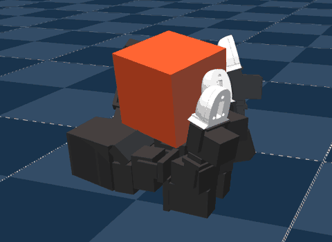

# LEAP Hand (`leap`)



Source: https://github.com/Msornerrrr/in-hand-rotation-mjlab (Apache-2.0; the LEAP hand
model is MIT) · demo video: https://www.youtube.com/watch?v=5JPbPGIz82w

A LEAP hand, palm up, turning a cube about the vertical with its fingertips, with the
sample checkpoint upstream ships for its custom left hand. Each episode starts from a
grasp drawn from upstream's grasp cache, the cube resized a few percent, and lasts until
the cube falls or flies off. Upstream follows [HORA](https://github.com/haozhiqi/hora)'s
task design and takes the hand from
[LEAP Hand Sim](https://github.com/leap-hand/LEAP_Hand_Sim).

Upstream registers three tasks; this one ports the one with a checkpoint:

| Upstream task | Here |
|---|---|
| `Mjlab-Leap-Left-Custom-HandCube-Rotate`, the custom left hand | the scene, with `ckpts/leap_left_custom_model_4900.pt` |
| `Mjlab-Leap-Left-HandCube-Rotate`, `Mjlab-Leap-Right-HandCube-Rotate` | left out: no checkpoint of their own |

## Run

```sh
uv run msp run leap
```

The first build clones the repository into `.cache/in_hand_rotation_mjlab/` at a pinned
commit and exports the checkpoint to ONNX once, with mjlab's own runner, into
`.cache/leap/`; set `MJSWAN_LEAP_ROOT` to point at a checkout you already have. Upstream
is not a package the playground installs: [`upstream.py`](upstream.py) imports its tasks
from the checkout's `src/`.

| From `in-hand-rotation-mjlab` | Used as |
|---|---|
| `Mjlab-Leap-Left-Custom-HandCube-Rotate` (`play=True`) | the scene, the observations, the action term, the terminations and the reset events, changed as below |
| `ckpts/leap_left_custom_model_4900.pt` | the policy (320 → 16): rsl_rl's actor with its observation normalizer; the joint order and grasp pose come from mjlab's env as the export builds it |
| `src/in_hand_rotation_mjlab/tasks/hand_cube/cache/leap_left_custom_grasp_cache.npz` | the 7,700 grasps a reset draws from |
| `src/in_hand_rotation_mjlab/robots/leap_hand/xmls/` | the hand and its meshes, with their MIT license |
| `LICENSE` | the project's license |

## What the policy reads

Two terms, ten frames each, oldest first: 320 values.

| Term | Width | Source |
|---|---|---|
| `joint_pos` | 16 | the joint positions less the grasp pose, as `joint_pos_rel` reads them |
| `prev_commanded_joint_pos` | 16 | the action term's target, as the last action left it |

## How it acts

Through upstream's own `JointPositionDeltaAction`. Each output, clipped to [-1, 1], moves
its joint's target by up to 1/24 rad from the last one, held to the soft joint limits.
The PD target ramps from the last target to the new one across the ten 5 ms physics steps
of each 20 Hz control step, and reaches the motors 10 physics steps (50 ms) late. mjswan
traces the term's `process_actions` and `reset`, and runs the ramp natively once
[`main.py`](main.py) names it with `mjswan.register_action`.

## What differs from upstream

- **No domain randomization.** Upstream's play keeps training's `dr_*` events: the cube's
  mass and center of mass, contact friction, link masses, motor friction and damping,
  armature, PD gains, effort limits and the command delay. The browser runs the nominal
  hand and cube. Three of those events call functions mjlab 1.6 removed
  (`randomize_field`, `randomize_pd_gains`, `sync_actuator_delays`).
- **The command delay is 10 physics steps on every joint.** Play's `dr_action_delay`
  draws one lag from 5 to 15 for all joints at each reset, through
  `sync_actuator_delays`; 10 is the middle of that range. The actuators' own setting, 0
  to 20 held with probability 1, would keep the lag at 0: mjlab 1.6's delay buffer zeroes
  it at a reset, and a held lag is never drawn again. So the port sets the range to 10
  and the hold to 0.
- **The solver runs up to 20 iterations a physics step**, where upstream's config has 10
  for mujoco_warp. MuJoCo's C build, which the browser runs, stops short of its tolerance
  at 10 on the hand's contacts: with this policy and no command delay, the cube left the
  hand in 6 of 16 20-second episodes there, against none of 8 in mjlab. 20, 30 and 50
  iterations give the same runs there, so 20 converges.
- **No `cube_pose_deviation` termination.** Its `reset()` records the cube's pose before
  mjlab 1.6 runs forward kinematics after the grasp reset, so it ends every episode on its
  first step; and a term that keeps state from its `reset()` does not trace. `cube_fell`
  (below 0.2 m), `cube_too_fast` (above 1 m/s) and `nan` still end an episode. Play's
  episodes never time out.
- **No `frame_viz` command**: the palm and cube frames mjlab's viewer draws.
- **No observation delay.** Training reads `joint_pos` 0 or 1 control step late; the
  browser reads it as it is, the 0-step end of that range.
- **Three terms are restated** in [`terms.py`](terms.py), for the build and parity alike:
  - `joint_pos_commanded` returns the action's target. Upstream's looks up `target_ids`
    with a `getattr` default, which the tracer refuses, so its graph would read
    `joint_pos_target` instead. The action drives every joint in order, so the two agree
    in mjlab, to the bit, on every step of a 400-step rollout of 8 envs.
  - `nan_detection` is mjlab's without the in-place `|=` the ONNX exporter refuses, as in
    `asimov` and `wuji`.
  - `reset_from_grasp_cache` takes the cache in its params, sorted by size at build time,
    and finds the nearest size as the count of smaller ones. Upstream keeps the cache on
    the env, which the tracer does not serve, and calls `searchsorted`, which ONNX has no
    operator for. From the same draws, the two set the same cube size and pose, to the
    bit, over 20 resets of 8 envs.
- **Shims for mjlab 1.6**, in [`upstream.py`](upstream.py). Upstream depends on unpinned
  git mjlab and was written for about 1.1: its `DelayedActuatorCfg` becomes the delay
  fields 1.6 puts on every actuator config, `TerrainImporterCfg` becomes
  `TerrainEntityCfg`, `EventTermCfg` loses `domain_randomization`, and `RslRlModelCfg`'s
  `stochastic` and `init_noise_std` become a Gaussian `distribution_cfg`. The robot
  constants point `update_assets` at a directory that does not exist, which mjlab 1.2
  skipped; the shared shim now skips it too.

## How it behaves

The hand walks its fingertips around the cube and turns it clockwise, seen from above,
keeping it in the palm. In mjlab, with this scene's config, 8 envs over 400 control steps
(20 s) turn it at 0.31 to 0.37 rad/s (mean 0.34), about 6.8 rad each, and none ends its
episode. Rolled out in MuJoCo's C build with the browser's action, delay and PD, 32
episodes of 20 s turn it at 0.23 to 0.35 rad/s (mean 0.33), and none drops it.
