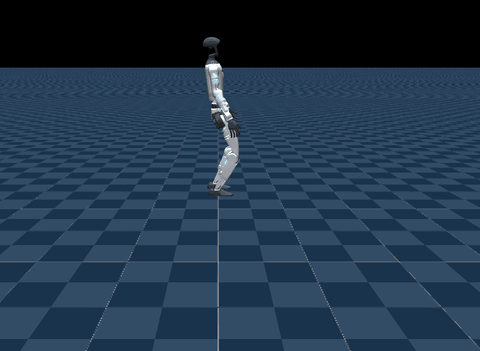

# ORCS (`orcs`)



Source: https://github.com/lok-i/orcs (BSD-3-Clause), with its dependencies
https://github.com/lok-i/mocke (BSD-3-Clause; Apache-2.0 for the SONIC code it adapts) and
lok-i's fork of rsl_rl, https://github.com/lok-i/rsl_rl (BSD-3-Clause) · checkpoints from
https://huggingface.co/lkrajan/orcs (NVIDIA Open Model License: they build on SONIC's
weights) · clips and terrain from OmniRetarget (MIT) and NVIDIA's GRAIL (**CC BY-NC 4.0**,
see [License](#license)), and a clip from `l-k-r/retargeted_motions` (MIT) · a tire from
https://github.com/drcl-deploy/assets (no terms stated; held to **CC BY-NC 4.0**) · the
G1 is mjlab's (Unitree, BSD-3-Clause)

> Lokesh Krishna, Sarvesh Venkatesan, An Zhang, Quan Nguyen.
> [ViBe: Visual Behavior Adaptation for Perceptive Humanoid Whole-Body Control](https://arxiv.org/abs/2609.09918).
> 2026. arXiv:2609.09918.

ORCS trains the privileged teachers behind ViBe: a Unitree G1 on NVIDIA's frozen SONIC
whole-body controller, with a LoRA adapter on its decoder that reads what the task needs.
The four policies upstream releases run here, one scene each:

- **Orcs-Dodge-AdaptSonic** holds a stand while a ball is thrown at it every 1 to 4 s,
  and ducks or steps aside. Its adapter reads the ball's position and velocity.
- **Orcs-PerLoco-OmRe-AdaptSonic** walks up onto a box and over it, along an
  OmniRetarget clip. Its adapter reads a 187-ray height scan.
- **Orcs-PerLoco-Grail-AdaptSonic** walks over a row of curbs, along a GRAIL clip, with
  the same scan.
- **Orcs-Uolm-AdaptSonic** rolls a 9.6 kg tire forward along a retargeted clip that
  takes it 1.3 m in 13.8 s. Its adapter reads the tire's pose and twist, which object of
  its roster of six the tire is, the pose the clip leaves the tire in, and which of its
  bodies the clip has touching the tire. It rolls the tire farther than the clip, and
  falls about 13 s in, before the clip ends; upstream's play config falls the same way in
  mjlab, so the fall is the checkpoint's.

Left out:

- The three `-TaRa` tasks, PerLoco's two and Uolm's, and the four `-Smpl` tasks, PerLoco
  GRAIL's and Uolm's three: no released checkpoint, and the `-Smpl` ones need licensed
  SMPL-X body models.
- `Mocke-Tracking-Textop-G1` and `Mocke-Tracking-Sonic-G1`, which the mocke dependency
  registers, not ORCS.

## Run

```sh
uv sync --extra orcs   # onnxruntime and usd-core, for the conversion and GRAIL's curbs
uv run msp run orcs
```

`orcs-open` builds Dodge and Climb alone, without the two scenes a non-commercial license
covers (see [License](#license)): it is what the GitHub Pages site and mjswan Cloud carry,
and it fetches none of the curbs' and the tire's data.

The first build clones the three repositories into `.cache/orcs/` at pinned commits (mocke
carries its pretrained weights in git, 210 MB, which the port does not read), and
`drcl-deploy/assets` without its Git LFS objects; set `MJSWAN_ORCS_ROOT`,
`MJSWAN_MOCKE_ROOT`, `MJSWAN_ORCS_RSL_RL_ROOT` and `MJSWAN_ORCS_ASSETS_ROOT` to use
checkouts you have. It then makes the data upstream's setup scripts make, under
`.cache/orcs/data/` (upstream's own `ORCS_DATA_ROOT` moves it): Dodge's nominal stand
through `orcs-make-nominal`, each PerLoco roster's tiles and clips through
`orcs-stage-terrain`, from the dataset files it reads, and Uolm's six roster clips, all
fetched from the Hub at pinned revisions. It fetches the tire's ten LFS files from
GitHub's media host, each checked against its pointer's size and hash, and runs the
repository's `assets generate` on the tire alone, into `.cache/orcs/objects/`. Last, it
converts each checkpoint into `.cache/orcs/onnx/`, in a process with the rsl_rl fork
first on `PYTHONPATH`, since mjlab's own rsl_rl lacks its model.

| From | Used as |
|---|---|
| `orcs`: `Orcs-Dodge-AdaptSonic` and `Orcs-Uolm-AdaptSonic` (`play=True`), and the PerLoco play configs from `omni_env_cfg` and `grail_env_cfg` | each scene: the robot, its observations, action, terminations, sensors and terrain |
| `orcs`: `orcs-make-nominal`, `orcs-stage-terrain`, `rosters/omni.toml`, `rosters/grail.toml` | Dodge's stand, and the PerLoco tiles and clips |
| `orcs`: `assets.objects`, `core.data.retargeted` | the tire as an entity, and its slot in the roster |
| `orcs`: `src/orcs/release.json` | each checkpoint's path, size and hash |
| `orcs`: `LICENSE`, `NOTICE` | the project's license and notice |
| `mocke`: `sonic.profile`, `sonic_g1_tokenizer` | the frozen base's streams, its action scale and actuator grouping, and its tokenizer |
| `rsl_rl`: `SonicWithAdapterModel` and its ONNX wrapper | each checkpoint's conversion, LoRA folded into the decoder |
| `lkrajan/orcs` at v0.1.0: `<task>/checkpoint.pt`, `LICENSES/NVIDIA-OPEN-MODEL-LICENSE.txt` | the three policies, and their license |
| `omniretarget/OmniRetarget_Dataset`: `robot-terrain.zip`, `models/terrain/climb_{16,17,18}`, `models/g1/g1_29dof.urdf` | the OmniRetarget roster's nine tiles and clips |
| `nvidia/PhysicalAI-Robotics-Locomanipulation-GRAIL`: `data/curb/{robot,object_usd}` for the roster's eight curbs | the GRAIL roster's tiles and 63 clips |
| `l-k-r/retargeted_motions` at `e635ed6`: `data/unitree_g1/<clip>/{metadata.json,*.npz}` for the six clips upstream's `lfs_include` picks | the Uolm roster, one clip an object, of which the scene plays the tire's, `custom/tire_roll/sample1` |
| `drcl-deploy/assets` at `90e2260`: `custom_objects/tire/` (mesh, eight convex parts, `metadata.json`), `textures/tire.png`, `assets generate` | the tire's model, without the texture |

| Scene | Policy | Checkpoint | Input → action | Rate |
|---|---|---|---|---|
| Orcs-Dodge-AdaptSonic | Dodge | `Orcs-Dodge-AdaptSonic/checkpoint.pt` (model_7500) | 640 + 930 + 21 → 29 | 50 Hz |
| Orcs-PerLoco-OmRe-AdaptSonic | Climb | `Orcs-PerLoco-OmRe-AdaptSonic/checkpoint.pt` (model_10500) | 640 + 930 + 202 → 29 | 50 Hz |
| Orcs-PerLoco-Grail-AdaptSonic | Curb | `Orcs-PerLoco-Grail-AdaptSonic/checkpoint.pt` (model_14999) | 640 + 930 + 202 → 29 | 50 Hz |
| Orcs-Uolm-AdaptSonic | Tire | `Orcs-Uolm-AdaptSonic/checkpoint.pt` (model_19999) | 640 + 930 + 57 → 29 | 50 Hz |

No encoder bias: play strips upstream's `rand_encoder_bias`, so mjlab runs with none.

## What the policies read

Three inputs, in the actor's own order:

| Input | Width | Source |
|---|---|---|
| `tokenizer` | 10 × 64 | SONIC's G1 encoder: the reference at 10 frames 0.1 s apart, each its joint positions and velocities (29 each) and its pelvis orientation relative to the robot's (6) |
| `actor` | 10 × 93 | SONIC's decoder, 10 frames of `base_ang_vel`, `joint_pos`, `joint_vel`, `actions` and `gravity_dir` (3, 29, 29, 29, 3) |
| `augmentation` | 21, 202 or 57 | the adapter's: Dodge's ball position and velocity in the robot's yaw frame (6); PerLoco's height scan, 17 × 11 rays 0.1 m apart under the pelvis, yaw-aligned, over 5 m (187); then the root's position and body-frame twist (9) and the reference's root twist (6, zero for Dodge's stand). Uolm's opens on the tire's position, orientation and twist in the world frame (15) and a one-hot of its slot in the roster (6), then has the root's (9), the clip's last tire pose (9), the clip's contact flags between the tire and 12 of the robot's bodies (12), and the root twist (6) |

## What differs from upstream

- **mjlab 1.6.0.** Upstream pins mjlab 1.4.0 and mujoco 3.8.1, and imports unchanged on
  1.6.0: between the two, the G1 constants only spell out `FULL_COLLISION`'s defaults,
  and the G1's built-in position actuators are the same. The port imports the task
  packages rather than `orcs.registration`, whose `_mjlab_compat` patches mjlab's train
  and play scripts and caps mujoco_warp's collision workspace, neither of which the build
  runs.
- **The hands look like mjlab's.** Upstream's flat-hand G1 swaps each hand's capsule
  collider for a box plate, and its visual mesh for a flat hand from
  `drcl-deploy/assets`, whose G1 meshes record no license. The plates are here; the
  visual stays mjlab's hand, and visual geoms collide with nothing.
- **The reference clip is a traced command.** Upstream's `MultiClipMotionCommand`, and
  PerLoco's `TerrainMotionCommand` over it, keep an integer frame, which the browser feeds
  a graph as a float, so [`terms.py`](terms.py)'s `ClipCommand` restates them over the one
  clip each scene plays: frame zero with upstream's reset jitter, the frame advanced and
  held at the clip's end, and the anchor rows the twist observations read. SONIC's
  tokenizer reads it unchanged, its clip tables baked into the graph. Against upstream's
  command in mjlab, the reset's writes, the tokenizer, the twist observations and
  `exceeded_motion` agree exactly, over 20 reset draws and full rollouts. Uolm's
  `ObjectMotionCommand` is restated the same way, as `ObjectClipCommand`: the tire
  written onto the clip's first frame after the robot, and the clip's contact flags and
  last tire pose, the goal upstream sets on each reset, held as fields. Against
  upstream's play config in mjlab, its sim's variant table giving the one env the tire,
  the reset's writes, every observation and the episode's end agree exactly over 900
  steps. No reference ghost is drawn.
- **Dodge's throw is a command.** Upstream's `ThrowBall` is an interval event with a
  countdown and a flight timer that pins the ball overhead between throws; mjswan traces
  an event as a stateless function and lets a command write the sim only when it
  resamples. So `ThrowBallCommand` is resampled every control step, and its resample is
  the event's tick: play's own throw (from the robot's front cone, no camera, no
  ball-free anchors), its pin and launch merged into one write, and `ThrowBall.reset` on
  the first tick of each episode, which it reads off the clip command's frame. With every
  draw pinned, its writes match `ThrowBall`'s over 400 ticks. It runs after the step's
  forward, as mjlab 1.4.0 ran interval events; 1.6.0 runs them before.
- **One tile per PerLoco scene.** The browser runs one env, where upstream's play spreads
  envs over its roster's tiles: nine OmniRetarget climbs, and eight GRAIL curbs with 5 to
  10 clips each. Each scene stages upstream's whole roster and plays the roster's first
  tile and that tile's first clip, through a roster file of upstream's own format:
  `climb_16` at z-scale 1.0, its box drawn at upstream's 0.75, and `curb_000` take 000.
- **One object for Uolm.** Upstream's play deals the roster's six objects to its envs in
  turn, each env tracking its object's one clip. The scene is the env the tire gets: the
  tire, at its slot in the roster, and its clip, `custom/tire_roll/sample1`, at 13.8 s the
  roster's longest. All six clips are staged, since the config looks each object's clip
  up and sizes the episode by the longest. Upstream's own registration skips the task
  here, its config spawning the six objects from models `assets generate` makes; the port
  registers the same row again with the tire alone, through the row's own
  `_object_entity`, so only the tire's meshes are fetched.
- **The roster slot is a constant.** `object_id_onehot` reads each env's slot off the
  command as an integer, which the browser would hold as a float; the rewrite returns
  the tire's one-hot, slot 4 of 6, without the command.
- **The env origin is the world's.** `robot_root_pos_env`, and Uolm's
  `object_pos_w_obs`, subtract `env.scene.env_origins`, which mjswan serves no
  observation; for the browser's one env, at the world's origin on a plane or a one-tile
  grid, the rewrites read the root's position alone.
- **The tire is drawn in one gray.** Its tread texture, `textures/tire.png`, records no
  source; the tire's material takes the texture's mean color instead. Its collision
  parts and inertia are `assets generate`'s.
- **Training-only terms are dropped:** `PolicyUpdateCounter`, an event that counts PPO
  updates for upstream's anneals and curricula, the critic group and the rewards, and
  `ObjectMotionCommand`'s log of how far the robot's contacts with the object stray from
  the clip's.
- **The checkpoints are converted here.** The release ships `.pt` only. Each is rebuilt
  with the fork's `SonicWithAdapterModel` and exported through its own ONNX wrapper,
  then checked against the fork's forward pass on random inputs, to within 1e-5 of the
  largest action: float32's rounding grows with the actions, and those inputs drive
  Uolm's past 100. The decoder's weights are stored as float16 and cast back in the
  graph, so each file fits mjswan Cloud's 50 MB; along a 60 s Dodge rollout in mjlab,
  they move the actions by at most 9.6e-4, and along Uolm's episode by 8.8e-3. The
  encoder stays float32: its output is rounded into tokens, which a float16 weight could
  flip.
- **mocke's sandbox tasks are skipped.** Importing mocke registers two play-only tasks
  on mjlab's demo clip (LAFAN1, CC BY-NC-ND 4.0), downloading it; the port fails that
  fetch, so they skip as mocke does offline.
- **GRAIL's clips are read with numpy arrays allowed only.** They are joblib pickles,
  which upstream's staging loads whole; here any class but joblib's array wrapper, numpy's
  dtype and ndarray is refused, so a download cannot run code.

## License

The curb scene plays GRAIL's `curb_000`, its geometry and its clip, under the Creative
Commons Attribution-NonCommercial 4.0 license ([`LICENSE.grail`](LICENSE.grail)), and the
checkpoints are under the NVIDIA Open Model License, whose text and attribution each scene
carries. The tire scene's clip is MIT, as the front matter of its dataset's card,
`readme.md`, declares (the Hub shows a card only from `README.md`, so lists no license);
`drcl-deploy/assets` states no terms for the tire, so the scene holds the tire to the
curb's, CC BY-NC 4.0, and takes it down at an owner's request
([`LICENSE.tire`](LICENSE.tire)). Neither scene goes on the GitHub Pages site or mjswan
Cloud, which carry `orcs-open`. The demo is published only by its author.
