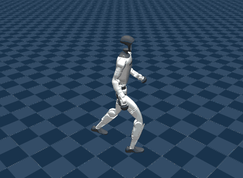

# Parkour MJLab (`parkour`)



Source: https://github.com/yhx1203/parkour_mjlab, which trains PIE's Go2 and ports PHP to
mjlab (Apache-2.0 with its policies, see [License](#license); its G1 model is Unitree's,
BSD-3-Clause, and its Go2 model is Unitree's from mujoco_menagerie, BSD-3-Clause) · PHP's
motion clips and their boxes from https://github.com/amazon-far/php_parkour, release
`training-motion-examples-v1` (Apache-2.0)

> Shixin Luo, Songbo Li, Ruiqi Yu, Zhicheng Wang, Jun Wu, Qiuguo Zhu.
> [PIE: Parkour with Implicit-Explicit Learning Framework for Legged Robots](https://arxiv.org/abs/2408.13740).
> IEEE Robotics and Automation Letters, 2024. arXiv:2408.13740.

> Zhen Wu, Xiaoyu Huang, Lujie Yang, Yuanhang Zhang, Xi Chen, Pieter Abbeel, Rocky Duan,
> Angjoo Kanazawa, Carmelo Sferrazza, Guanya Shi, C. Karen Liu.
> [Perceptive Humanoid Parkour: Chaining Dynamic Human Skills via Motion Matching](https://arxiv.org/abs/2602.15827).
> RSS, 2026. arXiv:2602.15827.

parkour_mjlab trains perceptive locomotion on mjlab: a Unitree Go2 on stairs with PIE,
and a Unitree G1 doing Amazon FAR's PHP parkour skills. Every policy it ships for a task
in the repository runs here, one scene each:

- **Unitree-Go2-PIE** walks the twist its sliders set over stairs it sees through a front
  depth camera, with a GRU memory of what it saw.
- **Unitree-G1-PHP-Locomotion-Teacher**, **-Low-Step-**, **-High-Step-**, **-Low-Climb-**
  and **-High-Climb-Teacher** each track the first clip of their skill's PHP bundle,
  over that clip's boxes, reading a height scan: a walk with turns, steps onto 0.35 m
  boxes at a walk and at a run, and climbs onto 0.76 m boxes at a walk and at a run.
- **Unitree-G1-PHP-Student**, the depth student the five teachers distill into, plays
  High-Climb's first clip from the clip's one-hot velocity command and a head depth
  camera alone, without the reference motion the teachers read.

Left out: the G1 stair policy (`logs/rsl_rl/g1_stair/stair_test/policy.onnx`), whose task
is not in the repository ("Release the G1 Goal Stair code" is unchecked), and
`deploy/parkour`'s two ONNX files: `amp_policy.onnx` is a run of another repository,
humanoid_amp_mjlab, and `student_policy_v6_model_10000.onnx` trains on
`Unitree-G1-Direction-Mixed-Student-V6`, which the repository does not have either.

## Run

```sh
uv run msp run parkour
```

`parkour-open`, what the GitHub Pages site and mjswan Cloud carry, leaves out the scenes a
non-commercial license covers, and so builds them all: none is (see [License](#license)).

The first build clones parkour_mjlab into `.cache/` at a pinned commit (399 MB with its
checkpoints); set `MJSWAN_PARKOUR_ROOT` to use a checkout you have. It then downloads
PHP's five motion bundles (306 MB), checks each against the sha256 the release lists, and
extracts them where upstream's README puts them, `src/assets/motions/php_motion/`:
importing upstream's tasks reads every bundle. Last, under `.cache/parkour/`, it exports
each teacher's `model_20000.pt` once with mjlab's own runner, and writes each scene's
clip in the layout mjlab's motion command reads.

| From `parkour_mjlab` | Used as |
|---|---|
| `Unitree-Go2-PIE` and the six `Unitree-G1-PHP-*` tasks (`play=True`) | each scene: the robot, its terrain or boxes, observations, action, commands, terminations and events |
| `logs/rsl_rl/go2_pie/policy.onnx` | PIE's policy, upstream's own export, wrapped (see below), and its joint order and default pose |
| `logs/rsl_rl/g1_php_<skill>_teacher/model_20000.pt` | each teacher, converted |
| `logs/rsl_rl/g1_php_student/model_23000.onnx` | the student, upstream's sim2sim export, and its joint order and default pose |
| `src/assets/robots/unitree_g1/LICENSE` | the G1 scenes' attribution |
| `LICENSE`, `NOTICE` | the project's license and notice |

| From `php_parkour`, release `training-motion-examples-v1` | Used as |
|---|---|
| `php-motions-<skill>-v1.tar.gz`, five bundles | the tasks' clips: each teacher plays its bundle's first, `*_motion.npz`, over its `*_terrain.npy` boxes, variant 0 |

| Scene | Policy | Checkpoint | Input → action | Rate |
|---|---|---|---|---|
| Unitree-Go2-PIE | PIE | `go2_pie/policy.onnx` (model_8000) | 45 + 450 + 2 × 60 × 86, GRU 128 → 12 | 50 Hz |
| Unitree-G1-PHP-<skill>-Teacher | Locomotion, Low-Step, High-Step, Low-Climb, High-Climb | `g1_php_<skill>_teacher/model_20000.pt` | 449 → 29 | 50 Hz |
| Unitree-G1-PHP-Student | Student | `g1_php_student/model_23000.onnx` | 104 + 58 × 87 → 29 | 50 Hz |

## What the policies read

**PIE** reads three inputs and keeps a fourth:

| Input | Width | Source |
|---|---|---|
| `proprio` | 45 | `base_ang_vel` (the `imu_ang_vel` sensor), `projected_gravity`, the twist, `joint_pos` and `joint_vel` against the default pose, the last action |
| `history` | 10 × 45 | the same terms, ten control steps, oldest first, term by term |
| `depth` | 2 × 60 × 86 | two depth frames 5 control steps (0.1 s) apart, each the front camera's 106 × 60 image less ten columns on each side: the distance along each pixel's ray, misses at 3 m, a 3 × 3 Gaussian blur, clipped to 0.05 to 3 m and divided by 3 m |
| GRU | 128 | its hidden state, from the previous step |

**The teachers** read mjlab's tracking actor, the reference's joint positions and
velocities (58), its anchor position and orientation in the robot's torso frame (3 + 6),
`base_lin_vel`, `base_ang_vel`, `joint_pos`, `joint_vel` and the last action, then a
height scan: 17 × 17 rays 0.1 m apart under `torso_link`, yaw-aligned, onto group 0 (289).

**The student** reads `proprio` (104): gravity in the torso frame, the pelvis gyro,
`joint_pos`, `joint_vel`, the last action, and the clip's one-hot velocity command (one of
11: stand, forward, run forward, and turns of 45 and 90 degrees each way). And `depth`
(58 × 87): the head camera's 106 × 60 image, rows 2 down and columns 4 to 101, as
optical depth clipped to 0.3 to 3 m, blurred 3 × 3, resized bicubically to 58 × 87 and
normalized, as upstream processes it, 3 control steps old.

## The depth cameras, as rays

mjswan serves raycasts, not rendered frames, so each camera here is a `RayCastSensor`
that casts the camera's own pixel-centre rays from the camera's pose on its body: only the
pixels upstream keeps after its crop, 5,160 for PIE and 5,684 for the student.
[`terms.py`](terms.py) restates upstream's processing on the ray distances, the student's
bicubic resize as the linear map it is. Upstream's own PHP sim2sim casts the student's
depth the same way (`--depth-backend ray`, its default).

- **Ray distance, as upstream trained.** Upstream pins mujoco-warp 3.5.0, whose camera
  reports each pixel's distance along its ray; PIE's deploy code says so, and the
  student's term turns it into optical depth. The playground's mjlab 1.6 runs
  mujoco-warp 3.11, whose camera reports optical depth instead, so upstream's own terms
  would read it wrong there; the rays report the distance upstream trained on. Against
  3.11's camera converted back, in mjlab, PIE's frames agree to 2e-5 and the student's to
  within 1e-4 over full rollouts, and the policies' actions are the same on either.
- **One call per camera, not per ray.** mjswan 0.12.1 cast each ray with its own
  `mj_ray` call through the WASM binding, which costs far more than the ray: 19.5 ms a
  step for the student's camera, and both depth scenes fell to 40 to 43 of their 50
  control steps a second. mjswan 0.12.2
  ([mjswan#172](https://github.com/ttktjmt/mjswan/pull/172)) casts a camera's rays, all
  from one point, in one `mj_multiRay` call: 1.3 ms, with the same readings, and both
  scenes hold 48 to 49. The playground requires it.
- **PIE's rays test the terrain alone,** group 0, where the camera renders groups 0 to 2.
  From the Go2's nose the camera sees nothing else: over two 30 s stair rollouts in mjlab,
  the robot's own meshes never reached the image, and the two agree exactly. The
  student's camera does see its own arms and knees, on half the steps of its clip, so its
  rays keep the camera's groups.

## How it behaves

In the browser, PIE climbs out of its spawn pit and down into the next at the sliders'
pace, and each teacher steps or climbs onto its boxes with its clip. The Locomotion
teacher loses its clip in the fast turns, 11.3 s in, and its `ee_body_pos` termination
starts the clip over: the turns are marginal for it, as in mjlab, where 0.02 rad of
action noise ends the same clip at 14.5 s. The student climbs High-Climb's boxes from
its camera alone, its arms reaching for the edge.

## What differs from upstream

- **mjlab 1.6.0.** Upstream pins mjlab 1.2.0 and mujoco 3.5.0. Importing it on 1.6 needs
  two shims ([`_compat.py`](../_compat.py)): `update_assets`, which 1.6 removed, and the
  `CollisionCfg` fields 1.6 made required. mjlab's tracking env config is the same in
  both, and its G1 constants differ only in how they load assets and spell out the
  collision defaults. On 1.6 an explicit `env.reset()` also advances each command once,
  which 1.2 did not.
- **PIE's twist is the operator's.** Play resamples it every 10 s, its yaw drawn by
  terrain type (upstream's `TerrainAwareVelocityCommand`). Here, as in upstream's own
  sim2sim (`--lin-vel-x 0.5`, then a gamepad or keys), sliders over play's ranges set it:
  forward 0 to 1.5 m/s from 0.5, a yaw rate of ±1.2 rad/s, `lin_vel_y` held at zero, as
  PIE trained. mjlab's own joystick would be the alternative, but mjswan 0.12.2 records
  its fixed `lin_vel_y` axis as a range companion and drops it, which moves the yaw slider
  onto `lin_vel_y`.
- **PIE's terrain is drawn once,** with seed 0, where play draws a new 5 × 5 grid of its
  tiles each run. Each reset lands on one of the 25 tiles' centres, as mjswan swaps
  `reset_base` for its flat-patch spawn; play re-draws the tile instead
  (`randomize_terrain`, a no-op here).
- **PIE's frame history and GRU state ride mjswan's carry.** Upstream's `DepthHistory`
  term keeps two frames, refreshed every 5 steps, and its runner keeps the GRU's state.
  [`pie.py`](pie.py) wraps `policy.onnx` in a graph that keeps both, and the step count,
  in `adapt_hx`, which mjswan zeroes at each reset: on an episode's first step it fills
  both frames, as `DepthHistory` does. In mjlab, fed the same observations as
  `DepthHistory` and the GRU, the wrapper's actions are identical over 150 steps, across
  a reset and a termination.
- **PHP's clips run on mjlab's own motion command.** Upstream's `PhpMotionCommand` plays
  a bundle's clips one after another, resizing and placing its mocap boxes for each. Here
  mjlab's `MotionCommand` plays the bundle's first clip from its first frame, as play's
  sequential draw begins, over that clip's boxes, baked into the scene where variant 0
  puts them; the clip is written in mjlab's layout, as float32 as upstream reads it. At
  the clip's end, mjswan's tracking command restarts the episode, where upstream's
  `motion_end` time-out does, and then plays the next clip. In mjlab, beside upstream's
  own env, the High-Climb teacher's observations agree to 1e-7 until upstream's
  `motion_end` fires on the clip's last frame.
- **The student plays High-Climb's first clip,** as upstream's README plays it; play's
  sequential draw would start on Locomotion's. Its velocity command is the clip's
  `vel_cmd` at a frame a clock command counts, since mjswan's tracking command serves no
  frame index; in mjlab it equals upstream's lookup on every one of 400 steps.
- **The student's depth is 3 steps old, kept in mjswan's carry.** Upstream's
  `PhpDepthImage` keeps six frames and feeds one 3 or 4 steps old, drawn each step.
  [`php.py`](php.py) wraps `model_23000.onnx` to keep three frames in `adapt_hx` and feed
  the one 3 steps old, every frame the current one on an episode's first step, as
  `PhpDepthImage` primes them; in mjlab its actions equal the export's fed those frames
  directly. The lag is not a `history_steps` on the term: mjswan 0.12.2 attaches a
  raycast's descriptor to a fused group only, and a term with a history does not fuse, so
  the browser never casts its rays.
- **The groups are renamed:** PIE's `actor`, `proprio_history` and `camera` to `proprio`,
  `history` and `depth`, and the student's `student_proprio` and `student_depth` to
  `proprio` and `depth`. mjswan refuses an actor its runner feeds several groups, while
  the exports take them as separate inputs.
- **`nan_detection` without `|=`** ([`_trace.py`](../_trace.py)): mjlab's own builds its
  mask in place, which `torch.onnx.export` refuses (`aten::__ior_`).
- **The teachers are converted here,** with mjlab's own runner and its export metadata,
  from the `.pt` files upstream publishes.
- **Dropped:** `php_box_fields`, a startup event that declares the box fields
  `place_boxes` resizes, which static boxes do not need; and what only training reads:
  the critic groups, rewards and curricula, PIE's estimator targets, and the student's
  `teacher`, `expert_id`, `phase_bin` and `dagger_valid` groups.
- **One randomized robot, not a population.** PIE's startup randomization survives the
  build (foot friction, a CoM offset and payload on `base_link`, PD gains and motor
  strength ±10%), drawn once by the browser's seeded PRNG. Its `encoder_bias` is the
  policy config's, which carries none.

## License

parkour_mjlab trains PIE's Go2 and ports PHP to mjlab, and PHP's README lists it among
its community projects. What the scenes carry:

- **parkour_mjlab's code and policies** are Apache-2.0: its `LICENSE` and `NOTICE`, which
  the project carries. Its `logs/LICENSE` puts the seven checkpoints here under it by
  name, browser demos and cloud-hosted inference included. Each scene's notice names its
  policy and says what the port changes: the teachers are exported to ONNX by mjlab's
  runner, and PIE's and the student's exports are wrapped to carry their state from step
  to step.
- **PHP's clips and boxes** are Amazon's, under Apache-2.0 like PHP's repository, and the
  release ships them unchanged. Each G1 scene carries the license and Amazon's notice,
  which also says what the port changes: the clip is rewritten in mjlab's layout, and its
  boxes are built into the scene. parkour_mjlab's license does not cover them, as its
  `logs/LICENSE` says.
- **The robots** are Unitree's under BSD-3-Clause: the G1 (upstream's
  `src/assets/robots/unitree_g1/LICENSE`, which every G1 scene carries) and the Go2.

Nothing here is under a non-commercial license.
