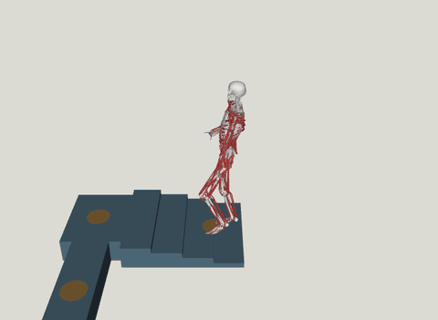

# TERRA (`terra`)



Source: https://github.com/MyoHub/myosuite (Apache-2.0), its tutorial 4.4 and its mjlab
waypoint task · policy [`merc-s/TERRA-4B`](https://huggingface.co/merc-s/TERRA-4B) (no
license stated, see [License](#license)) · TERRA's code:
https://github.com/amathislab/terra (Apache-2.0) · the body: `musclemimic_models`
(Apache-2.0) · project page: https://cnai.epfl.ch/terra/

> Merkourios Simos, Chengkun Li, Bianca Ziliotto, Alexander Mathis.
> [TERRA: Terrain-Aware Reconstruction, Retargeting and Control for Musculoskeletal Locomotion](https://arxiv.org/abs/2609.38653).
> arXiv:2609.38653, 2026.

A 354-muscle MyoFullBody walking waypoint routes with TERRA-4B, a terrain-aware full-body
muscle tracker: it follows a reference planned for each route over the terrain under it,
which it reads through an 11 x 11 heightmap. Two scenes:

- **TERRA-Course**: myosuite tutorial 4.4's course, four steps up, a beam with a
  right-angle turn, a jump onto a landing, three steps down and a second jump, through
  nine waypoints (the orange discs) in 39.5 s.
- **TERRA-Flat**: `myoFullBodyWaypoint-v0` as registered, four waypoints on flat ground
  along the route it draws at reset seed 0, in 30 s.

Each episode starts at the route's start and ends at the reference's end, or on a fall.

## Run

```sh
uv sync --extra terra          # myosuite's waypoint task and TERRA's helpers
uv run msp run terra
```

TERRA's code is on myosuite's
[`feat/programmatic-waypoint-tasks`](https://github.com/MyoHub/myosuite/tree/feat/programmatic-waypoint-tasks)
branch, which `[tool.uv.sources]` pins until it merges. The first build downloads the
checkpoint (90 MB) at myosuite's pinned revision, converts the actor to ONNX (24 MiB) and
checks it against myosuite's forward pass, and plans each route's reference, about 40 s
each, all into `.cache/terra/`.

| From myosuite | Used as |
|---|---|
| `myoFullBodyWaypoint-v0`'s mjlab twin (`play=True`) | each scene's config, with what TERRA reads in place of its own policy's terms |
| `build_terrain_fullbody_spec` | the body: `musclemimic_models` 1.0.5 with TERRA's muscle-wrap fixes and solver settings |
| tutorial 4.4's `course_scene` and its nine waypoints | the course, verbatim |
| `myoFullBodyWaypoint-v0`'s CPU env, reset with seed 0 | the flat route |
| `plan_waypoint_reference`, `GaitParameters(jump_flight_s=0.45, jump_tuck=0.16, second_jump_tuck=0.16)` | each route's reference, at 100 Hz, with the course's jumps on its sixth and eighth segments |
| `TerrainObservation` | the observation, restated in torch in [`terms.py`](terms.py) |
| `MimicActorModule`, `export_to_onnx`, `TERRA_REVISION` | the actor as ONNX |

| Scene | Policy | Checkpoint | Input → action | Rate |
|---|---|---|---|---|
| TERRA-Course | TERRA-4B | `merc-s/TERRA-4B` at `b89a604`, `checkpoint_24416` | 1459 → 354 | 100 Hz |
| TERRA-Flat | TERRA-4B | the same | 1459 → 354 | 100 Hz |

## What the policy reads

`obs[1, 1459] -> actions[1, 354]`. Six blocks are raw sim fields and the heightmap, read
every step; the last two compare the body with the reference, whose half is baked from
the planned clip into tables indexed by sim time.

| Block | Width | Source |
|---|---:|---|
| root height, and gravity in the root frame | 4 | `qpos` |
| joint positions | 82 | `qpos` |
| root velocity in the heading frame | 6 | `qvel` |
| joint velocities | 82 | `qvel` |
| per muscle: excitation, activation | 708 | `ctrl`, `act` |
| foot touch sensors | 4 | `sensordata` |
| heightmap, 11 x 11 at 0.1 m around the pelvis, relative to it | 121 | the `heightmap` raycast sensor, onto geom group 2 |
| errors against the next reference frame: root position, rotation and velocity; 16 sites' position, rotation and velocity relative to the pelvis | 204 | `site_xpos`, `site_xmat`, `cvel`, `subtree_com`, the clip's tables |
| the reference 0.2, 0.4, 0.6 and 0.8 s ahead: root pose and velocity, the sites, how far ahead, whether past the end | 4 x 62 | the clip's tables |

The browser casts the heightmap's rays itself with `mj_ray`, onto the floor and the
course's boxes, the only geoms in group 2.

| Compared | max \|Δ\| |
|---|---:|
| exported actor vs myosuite's numpy forward pass | 1.4e-06 |
| torch observation vs myosuite's `TerrainObservation`, 40 steps of the flat route in mjlab | 2.9e-06 |
| the same, the body put on every 25th frame of the course reference, as is and jittered: heightmap | 1.2e-07 |
| the same: everything else | 1.8e-06 |
| traced graph vs the torch observation, 16 steps | 9.5e-07 |

On the course the heightmap differs at rays within 1e-7 m of a box's edge, where
mjlab's float32 cast and myosuite's float64 one land on either side.

## What differs from upstream

- **The mean action.** The tutorial samples TERRA's actions; the browser runs the
  actor's mean, which reaches all four flat waypoints in 27.6 s in myosuite's own CPU
  env but often falls on the course. Four CPU runs of the course that differ only in
  floating-point rounding (numpy or ONNX actor, the scene as built here or as myosuite
  compiles it) fell at 11.5, 27.3 and 35.5 s, and one stayed up over the whole 39.5 s,
  7 of 9 waypoints within the tutorial's 0.12 m. myosuite's 9/9 run sampled its actions.
- **TERRA's body in the twin.** The twin builds the registered MyoFullBody
  (`musclemimic_models` 1.0.6) from its CPU registration; each scene takes
  `build_terrain_fullbody_spec`'s body and scene instead, with its solver options: 4
  iterations, 8 line-search iterations, no Euler damping. Each body's inertial is pinned
  as that spec compiles it: mjlab's scene would drop its compiler's 1 g and 1e-4 kg m²
  floors, which set the inertia of 24 bodies, the toes, tali and patellae among them.
- **TERRA's terms, not the twin's.** The twin's observation, its `route` command, the
  terminations that read it (`waypoints_done`, `failed` and the `sync_forward` before
  them) and its rewards and metrics are for a policy trained on the twin; TERRA reads
  none of them, and the command would need a command binding. Visual-only discs mark the
  waypoints, at the arrival radius of each route: the tutorial's 0.12 m and the
  registered 0.3 m.
- **The action term.** The twin's `MyoActionCfg` clips raw controls to `ctrlrange`,
  as `WaypointEnv.step` does, and has no mjswan counterpart. myosuite's
  `MyoMuscleActivationActionCfg` in `direct` mode does the same for this body, whose
  `ctrlrange` is `[-1, 1]` throughout, and mjswan runs it.
- **The episode.** It ends at the reference's end, or when `pelvis_mimic` drops below
  0.5 m as in the tutorial, where the registered task fails at 0.6 m and ends after 1500
  steps or at its last waypoint. It starts at `qpos0` moved onto the route's start, at
  rest, as the tutorial spawns, without the registered task's 0.01 rad of joint noise.
- **The heightmap's yaw.** TERRA turns its grid by the root's XYZ Euler yaw; mjlab's
  raycast sensor turns it by the heading of the root's x axis. The two agree on an
  upright body, and differed by at most 0.27° over the flat route.
- **Browser behaviour is not asserted.** Parity proves each graph matches mjlab under
  `mujoco_warp`; the browser runs MuJoCo's WASM build.

## License

TERRA-4B's model card states no license. MyoSuite's maintainers asked for this port, and
only the playground's author publishes it.
