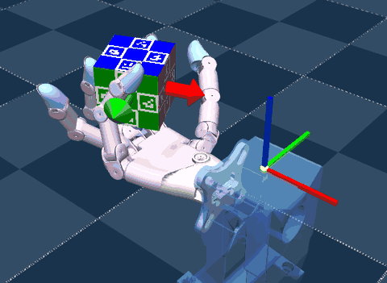

# Wuji Hand (`wuji`)



Source: https://github.com/wuji-technology/wuji-mjlab (Apache-2.0) · policy from its
[v2026.9.27 release bundle](https://github.com/wuji-technology/wuji-mjlab/releases/tag/v2026.9.27)
(Apache-2.0) · the Wuji Hand 2 model from
[wuji-description](https://github.com/wuji-technology/wuji-description) (MIT)

Wuji Hand 2, a 20-joint right hand on its mounting jig, turning a 54 mm cube in its palm
to orientations drawn uniformly at random. Three arrows out of the cube show the goal:
each points where the face of its color has to face (purple +X, red +Y, green +Z). Once
the cube has held within 0.2 rad of the goal for 13 control steps, the goal stays 1 s more
and then switches. Episodes last 60 s.

Upstream ships four simulations; this task ports one:

| Upstream task | Here |
|---|---|
| `WujiHand2_Reorient_50Hz`, Hand 2 turning the cube at 50 Hz | the scene, with the bundle's Hand 2 checkpoint |
| `WujiHand_Reorient`, Hand 1 turning the cube at 20 Hz | left out until the playground's preview recorder can check a 20 Hz scene ([#38](https://github.com/ttktjmt/mjswan_playground/issues/38)) |
| `WujiHand2_Reorient`, Hand 2 at 20 Hz | left out: no checkpoint of its own, the bundle's Hand 2 checkpoint is the 50 Hz recipe's |
| `WujiHand2_PenSpin`, Hand 2 spinning a pen | left out: `SingleHandResidualEMAActionCfg` smooths the policy's residual alone and adds it to a reference its own command plays, which no actuator filter can stand in for |

## Run

```sh
uv run msp run wuji
```

The first build clones the repository into `.cache/wuji-mjlab/` at a pinned commit and
downloads the 246 MB release bundle once, checks its sha256 and keeps the Hand 2
checkpoint and its `config.json` in `.cache/wuji/v2026.9.27/`; set `MJSWAN_WUJI_ROOT` to
point at a checkout you already have. Installed, upstream registers its tasks through mjlab's entry point;
[`upstream.py`](upstream.py) imports `wuji_mjlab.tasks` from the checkout's `src/` instead.

| From `wuji-mjlab` | Used as |
|---|---|
| `WujiHand2_Reorient_50Hz` (`play=True`) | the scene, the observations, the command, the terminations and the reset events, changed as below |
| bundle `reorient/checkpoints/hand2/policy.onnx` | the policy (207 → 20): run `RewardContactFix_Full_s42`'s `model_4999` |
| bundle `reorient/checkpoints/hand2/config.json` | the joint order and the default pose; its action scale, EMA factor and control period are checked against the config |
| `LICENSE`, `NOTICE` | the project's license and notice |

| Scene | Policy | Checkpoint | Input → action | Rate |
|---|---|---|---|---|
| `WujiHand2_Reorient_50Hz` | `hand2` | bundle `reorient/checkpoints/hand2` | 207 → 20 | 50 Hz, 100 Hz physics |

## What the policy reads

Five terms, three frames each, oldest first:

| Term | Width | Source |
|---|---|---|
| `noisy_joint_angles` | 20 × 3 | joint positions, normalized to the soft limits (play adds no noise) |
| `qpos_error` | 20 × 3 | the same, less the normalized smoothed target |
| `cube_pos_in_tag` | 3 × 3 | the cube's position in the wrist tag's frame |
| `cube_ori_error` | 6 × 3 | the last two rows of the rotation from the goal to the cube, in the tag's frame |
| `action_history` | 20 × 3 | the actions one to three steps back |

## What differs from upstream

- **The EMA action is the actuators' filter.** Upstream's
  `JointPositionOffsetEMAActionCfg`, a term of its own that mjswan has no counterpart for,
  clamps the action to [-1, 1], scales it by 0.5 about the default pose, clamps that
  target to the soft limits and smooths it with an EMA, 0.3 per 20 ms step. Here mjlab's
  `JointPositionActionCfg` applies the same scale and one clip per joint that equals both
  clamps, and each `<position>` actuator gets a `filterexact` filter with time constant
  `-dt / ln(1 - 0.3)`, 56 ms, settled at the default pose in the keyframe. The filter
  equals the EMA at the end of every control step; within one its target moves smoothly
  rather than jumping, about half a step later. Parity cannot check this side: rolled out
  in mjlab over 4 envs for 60 s, the checkpoint reached 28.0 goals a minute this way
  against 29.0 with upstream's term, and dropped the cube in neither.
- **`qpos_error` reads the filter state**, `act`, where upstream reads its action term's
  smoothed target ([`terms.py`](terms.py)).
- **`action_history` is mjlab's `last_action` one to three steps back.** Upstream's
  `previous_raw_action` reads the action manager's `prev_action`, the action before the
  last.
- **No warmup.** Upstream's term holds the default pose for the first 0.4 s of an
  episode; the filter starts there, and the policy acts from the first step.
- **The goal command is restated** in [`terms.py`](terms.py). Upstream draws its goals
  with `torch.rand`, which the tracer cannot replay; the rewrite draws the same uniform
  rotations with mjlab's `sample_uniform`, draws the next goal every step and takes it
  only on a switch, counts in float, and reads the wrist tag's world orientation once from
  the keyframe, since a traced command reads one entity and the mount does not move here.
  Its training counters are dropped, and so is upstream's status panel, a line of text
  with the orientation error.
- **The goal is drawn as arrows.** Upstream's viewer draws a ghost of the cube above it;
  mjswan's command drawings are spheres and arrows.
- **The mount does not tilt on reset.** `reset_robot_pose` turns the mocap mount about
  world axes by -0.4 to 0.1 rad, and mjswan's event tracer captures no mocap write, so the
  hand stays at its nominal pose, inside that range.
- **The other two reset events are restated** with `sample_uniform` where upstream calls
  `torch.rand` and `torch.rand_like`, over the same ranges: `reset_robot_joints` and
  `reset_object_pose`.
- **`nan_guard` is mjlab's `nan_detection`** with `|` in place of the in-place `|=` the
  ONNX exporter refuses.
- **The wrist tag's site is a term param**, which mjlab resolves once, where upstream's
  `cube_pos_in_tag` looks it up on every call.
- **Training-only terms are dropped:** the critic group, the rewards, the metrics, the
  contact sensors only they read, `reset_joint_acc_cache`, and `cage_drop`, which reads a
  reward's counter.
